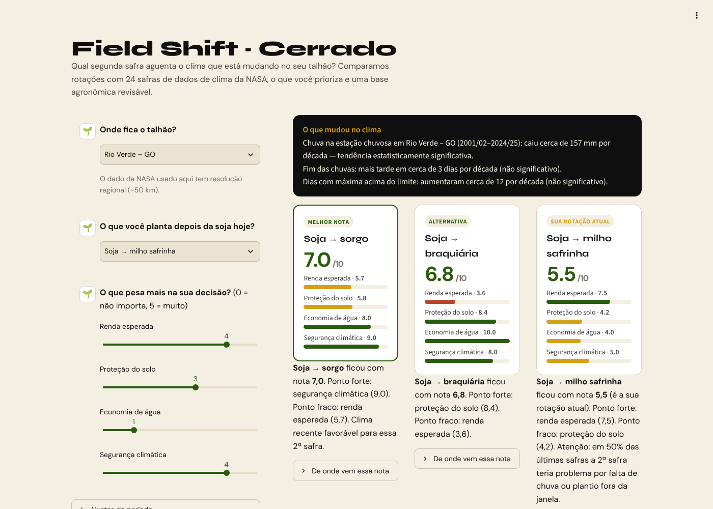

# Field Shift · Cerrado

Protótipo para o desafio **Field Shift: Adapting Farms with NASA Data** (NASA Space Apps Challenge 2026, Rio Verde-GO).

> Qual segunda safra aguenta o clima que está mudando no seu talhão?



O produtor informa onde fica o talhão, o que planta depois da soja e o que prioriza. A ferramenta usa 24 safras de dados diários de clima da NASA para comparar rotações (soja → milho safrinha, sorgo, milho + braquiária, milheto, crotalária, braquiária) e mostra a nota de cada uma com a evidência por trás de cada número.

## Rodar em 3 comandos

```bash
python -m venv .venv && source .venv/bin/activate      # Windows: .venv\Scripts\activate
pip install -r requirements.txt
streamlit run app/streamlit_app.py
```

Ou rode `setup/setup.ps1` (Windows) ou `setup/setup.sh` (Linux/Mac), que faz tudo e roda os testes.

Funciona **sem internet** para os 4 municípios de exemplo (Rio Verde, Jataí, Sorriso, Luís Eduardo Magalhães): os dados da NASA já estão em `data/exemplo/`.

## Como funciona

```
NASA POWER (chuva, temperatura, umidade do solo, diário, 2000–2025)
        │
        ▼
fieldshift/indicadores.py  → início e fim das chuvas, veranicos, calor, tendência por safra
        │
        ▼
fieldshift/motor.py        → simula a 2ª safra ano a ano (data de semeadura, chuva na fase crítica)
        │                     + base agronômica (data/conhecimento/*.json)
        │                     + prioridades do produtor
        ▼
nota por rotação, com evidência  →  fieldshift/explicar.py (texto por modelo fixo)  →  app Streamlit
```

**Regra de projeto:** quem decide a nota é o motor de regras, que é determinístico e auditável. Nenhuma IA escolhe a rotação.

## Estrutura

| Pasta | O que tem |
|---|---|
| `fieldshift/` | Núcleo em Python: dados da NASA, indicadores, motor de regras, explicação |
| `app/` | App em Streamlit |
| `data/exemplo/` | Séries da NASA POWER já baixadas (4 municípios) |
| `data/conhecimento/` | Base agronômica: culturas e rotações (**a validar**) |
| `scripts/` | `baixar_dados.py` para cachear novos pontos antes da demo |
| `tests/` | Testes (`python -m pytest`) |
| `docs/` | Proposta, desafio, método, dados, checklist do evento, pitch e log de validação |
| `setup/` | Scripts de instalação e lista de skills/MCPs para agentes de código |
| `claude-project/` | Instruções e prompt para usar com um Projeto no claude.ai |

## Stack

Python 3.10+, pandas, SciPy, Streamlit e Plotly. Tudo gratuito, roda local no notebook. O núcleo (`fieldshift/`) não depende do Streamlit: se o time quiser outro front depois, ele reaproveita o motor.

## Antes do pitch

1. Revisar `data/conhecimento/culturas.json` (todos os valores estão marcados `"validado": false`).
2. Conferir as janelas calculadas contra o ZARC (ver `docs/validacao.md`).
3. Ler os avisos de qualidade do dado em `docs/validacao.md` antes de citar qualquer tendência.

## Dados e créditos

- NASA POWER Project (NASA Langley Research Center), API diária por ponto, comunidade AG.
- Base agronômica inicial montada a partir de referências gerais da Embrapa; valores a validar.
